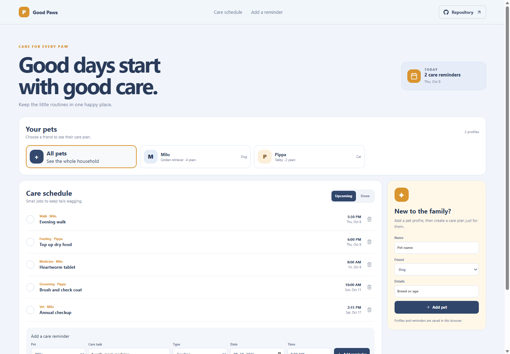

# Good Paws: Pet Care Scheduler

Good Paws keeps routine pet care in one shared schedule. Use it for daily feeding and walks as well as medicine, grooming, and vet appointments.

**GitHub Pages URL:** https://a2rp.github.io/pet-care-scheduler/ (available after deployment)

## Included

- Create pet profiles with a name, kind, and short detail.
- Add a care reminder for a selected pet with date, time, and care type.
- Switch between all pets or one pet, and upcoming or completed reminders.
- Mark a care task complete or reopen it later.
- Remove a reminder through a confirmation dialog.

## How to use it

Add each pet in the side form. Add reminders below the schedule, choosing which pet they belong to. Mark a reminder done when care is provided; use the pet cards to narrow the list.

## Data and limits

Pet profiles and reminders are stored in localStorage in this browser. The app does not send push notifications and does not replace veterinary advice.

This is a browser-only utility. Clearing the browser’s site data removes its saved information.

## Run locally

~~~sh
npm install
npm run dev
~~~

## Checks and deployment

~~~sh
npm run lint
npm run build
npm run deploy
~~~

The deploy command builds the project and publishes the dist directory to the gh-pages branch. It requires the project’s public GitHub repository to be configured as origin.

## Future improvements

Ideas only. These are not implemented yet:

- Add recurring schedules for daily care.
- Export vet visits to a calendar.
- Attach medication instructions and emergency contacts.

## Links

- Portfolio: [https://www.ashishranjan.net](https://www.ashishranjan.net)
- GitHub: [https://github.com/a2rp](https://github.com/a2rp)
- CodePen: [https://codepen.io/ash1198](https://codepen.io/ash1198)
- LinkedIn: [https://www.linkedin.com/in/aashishranjan](https://www.linkedin.com/in/aashishranjan)
- Facebook: [https://www.facebook.com/theash.ashish/](https://www.facebook.com/theash.ashish/)
- YouTube: [https://www.youtube.com/@ashishranjan-ashz?sub_confirmation=1](https://www.youtube.com/@ashishranjan-ashz?sub_confirmation=1)
- Email: [mailto:ash.ranjan09@gmail.com](mailto:ash.ranjan09@gmail.com)

## Support

- Support: [https://a2rp-donation-page.netlify.app/](https://a2rp-donation-page.netlify.app/)
- Buy Me a Coffee: [https://buymeacoffee.com/ashishranjan](https://buymeacoffee.com/ashishranjan)
- Patreon: [https://www.patreon.com/ashishranjan](https://www.patreon.com/ashishranjan)